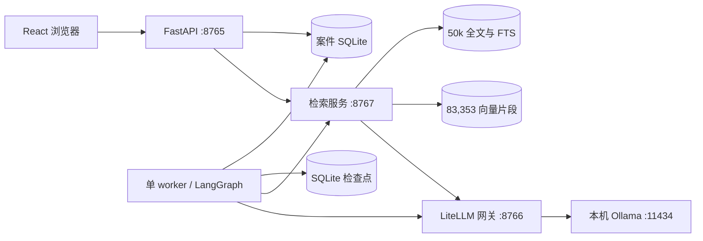

# 裁研 · 通用住房纠纷研究 POC

React + FastAPI + LangGraph + LiteLLM + 本地 Qwen/Ollama。复用既有 `index_50k` 的 SQLite 全文和 Qdrant 向量，提供案件材料上传、事实整理、证据分析、类案研究、民事起诉状与代理意见草稿、编辑复核和 Markdown 导出。

**珠海未完工楼盘案仅是验收样例。** 服务端没有该案的城市、当事人、金额、日期、案号或预设答案。代理立场、诉求、材料和选中案例都是案件输入。同一流程可用于商品房交付/质量/办证、二手房履行、租赁等争议；不同领域的法律适用仍需律师审核。

## 本机直接运行

```sh
cd /Users/cheny39/Documents/judger/chatbot-system-poc-1106
./start.sh
```

打开 <http://127.0.0.1:8765>。登录信息在 `data/local-credentials.json`，首次初始化随机生成，权限为 600。不要把该文件、`data/internal.key`、案卷数据或 `.env` 提交到版本库。

运行前须有本机 Ollama 服务及这两个已安装模型：

- 生成：`qwen3:4b-instruct`，固定别名 `caiyan-qwen4b-r1`。
- 嵌入：`qwen3-embedding:4b`，512 维，固定别名 `caiyan-embedding4b-r1`。

模型 digest、别名和服务映射写入 `data/model-profile.json`。映射变化时调用失败，不能静默更换权重。无云端模型兜底。`Ctrl+C` 停止此次启动的四个子进程；任务与检查点仍保留。不要同时启动第二套进程占用相同端口或同一个 Qdrant 目录。

## 在新环境安装

需要 Python 3.11+（本机实测 3.12）、支持 FTS5 的 SQLite、Node.js 20.19+ / 22.12+、npm、Ollama。首次安装会下载 Python/npm 依赖。

```sh
./setup.sh
./start.sh
```

`setup.sh` 使用本目录 `.venv` 和 `frontend/node_modules`。可设置 `POC_PYTHON=/path/to/python3`。已有虚拟环境不会被删除。

默认原始索引路径为相邻目录 `../judgment_research_poc/index_50k`。可通过 `CAIYAN_INDEX_DIR` 指定其他位置，但必须仍是相同模型、维度与结构的完整索引。`CAIYAN_DATA_DIR` 可切换整套本地工作数据目录。数据快照约 1.1 GB，原索引和 Ollama 模型不重复打包进源码。

## 使用流程

工作台展示已接入的裁判文书与原文片段数量、当前用户可访问的案件数量、待处理案件，以及最近案件的研究状态。通过「我的案件」管理材料与研究成果，通过「类案检索」查找参考裁判；工作台不再提供研究输入框。案件状态每 5 秒更新，语料统计每分钟更新，读取失败时展示重试入口。

案件汇总 API `GET /api/v1/cases` 的 `work_status` 表示当前案件版本的研究进度，不是诉讼状态：先显示待选择任务，其次是运行中、排队中任务，否则显示最新任务状态；尚无当前任务时按材料是否存在显示待添加材料或待开始研究。历史版本的已完成任务不计为当前研究已完成。「待处理案件」按案件去重，包含待选择和最新任务失败的案件。

新建案件和文本录入使用页面内展开表单；来源原文在当前页面上方展开，收起后返回原来的操作位置，保留检索、选案和编辑状态。操作结果与错误显示在页面内提示区，手机菜单也在页面中展开。官方来源链接在当前标签页打开。

案件「类案」中的「核对全文」从浏览器右侧滑入全文阅读面板：桌面端占浏览器宽度的 50%、高度铺满窗口，手机端占满宽度。面板以左侧阴影区分层次，正文不套卡片，保留紧凑的标题、检索片段入口与底部「移出类案（不相关）」操作。打开和关闭面板保留列表位置。移出后可立即撤销，也可在「已移出的类案」中查看和恢复。移出标记按案件持久保存，刷新或重新分析后仍会排除。若新的检索结果已不包含该文书，取消移出标记会让它重新参与后续检索，不会把旧文书插入新的检索结果。

相关性接口：`PUT /api/v1/cases/{cid}/similar-cases/{doc_id}/relevance`，请求包含当前类案 `version` 与 `relevant`（`false` 移出、`true` 撤销）。接口复用案件权限、CSRF 与版本冲突检查；原始检索快照不变，返回列表与案件计数扣除已移出文书，`excluded_items` 保留移出记录。

「我的案件」的每张案件卡片提供「编辑案件」，可在列表内修改名称、代理立场、诉求与研究日期。案件创建者还可点击「删除案件」，核对案件名称后确认删除；取消不会改变案件。删除后案件不再出现在列表、最近案件或工作台统计中，进行中和待选择的任务会取消，材料、成果及旧链接不可再访问。本机历史记录保留，当前不提供恢复入口。

案件管理沿用 `PATCH /api/v1/cases/{id}` 保存信息，并提供 `DELETE /api/v1/cases/{id}` 删除案件。两者均需登录、CSRF 校验及当前资料版本的 `If-Match` 请求头；版本变化返回 409。删除仅限案件创建者，其他案件成员返回 403，无访问权或已删除返回 404。删除成功返回 `{ "id": "…", "status": "deleted" }`，不物理清除本机历史文件和检查点。

「材料中心 → 案件材料」的每行提供「删除」，核对材料名称和影响后确认；取消不会发送删除请求。删除使用现有 `DELETE /api/v1/materials/{id}` 撤回接口，撤回该材料的所有版本，更新材料列表与案件计数，停止当前任务，并阻止读取原件及展示、导出引用该材料的成果。失败会保留确认区域供重试。本机历史文件仍保留，当前不提供恢复入口。

1. 新建案件，填写代理立场、诉求和研究日期。
2. 上传 DOCX、可提取文本的 PDF、TXT 或 Markdown，也可直接录入文本。原件与解析位置一起保存。扫描件和部分解析失败会明确提示，不静默忽略。
3. 在“结果与研究”右侧的“类案”和“本次材料范围”中各选 1–3 项，在主区域直接与 AI 聊天。六个常用提示词只填入消息，不自动发送。首次发送固定所选材料、类案及列表版本，右侧展示逐案研究过程，回复和后续追问保留在同一对话中。Enter 发送，Shift + Enter 换行，中文输入法选字不会误发送。通过“新对话”更换来源，旧对话及研究版本仍可查看。
4. 先在「类案」页按需要筛选并完成分析。「证据分析」展示该页已保留的结果，默认勾选前三个不同案件，可改选 1–5 个。开始后逐案分析，全部完成后汇总已有证据、建议补证及原因、至多十个待核问题；每个待核问题只显示一句问题和一句「为何重要」。条件或材料变化时先更新类案；不会另行执行未筛选检索。可继续追问证据，问答保留在本轮分析中；也可生成 Word，按生成时间保存到「材料中心 → 文书与研究文档」。Word 仅包含「已有证据与材料」「建议补充或核对的证据」（证据、获取渠道、为何需要）和「待核问题」。生成文档独立于原始材料，不进入下一轮证据输入。
5. 在“文书草稿”选择给定模板与材料中心参考材料，补充起草要求及逐材料阅读重点。各份材料独立阅读、全部响应收齐后按模板统筹起草，进展和后续交互留在文书页。任务在独立 worker 中运行，页面可刷新或关闭。
6. 在“文书草稿”点击段落来源核对原文，可直接编辑或继续提出修改要求。每个通过检查的新版本自动将 Word 保存到材料中心，供审阅与下载；人工复核后还可导出 Markdown。复核只表示使用者检查了这个版本。模板填写项、来源追溯与版本规则见 [文书工作流](docs/DOCUMENT_DRAFTS.md)。

“任务记录”保留后台长时间任务的完整进度、等待状态、错误和执行详情，不提供研究输入或选案表单。结果与研究的主界面不再堆叠历史待选择任务；从任务记录打开指定研究会话后可继续选择、取消或恢复，文书记录返回“文书草稿”。查看原文与后台轮询不会清空本轮选择和未发送消息。旧任务已固定的来源范围继续保留，新建研究每类来源最多 3 项。

“与 AI 讨论本案”右上角可切换全屏聊天，点击“还原”或按 Esc 返回；打开原文时，Esc 会先关闭原文。右侧“研究过程与来源”可收成窄栏，顶部左侧按钮可将工作区导航折叠为图标栏。普通布局的折叠偏好会在本机浏览器中保留，全屏退出后恢复原布局；切换布局保留草稿和选案。顶部导航高度缩为 48px，并减少案件标题与标签栏之间的留白。

在“案情时间线”点击“编辑时间线”，可修改事件日期、类型、内容与材料来源，也可新增、删除、上下调整顺序。日期支持保留年月等原文精度。事件类型提供预设下拉选项，也可搜索、输入并添加自定义类型；保存后的自定义类型可在本案其他事件中继续选择。材料来源从本案“材料中心”按文件列出全部当前材料，包括新上传的文件；原有引用片段可保留，新选择关联整份文件，不自动将任意片段当作事件依据。人工整理内容与原文分别保存。点击“保存修改”生成新版本，保留旧版并重置复核状态；“取消修改”放弃本次草稿。后台刷新不会覆盖草稿，另一页面保存新版时会提示冲突。

时间线保存沿用 `POST /api/v1/artifacts/{id}/versions`：传入原版本 `content_hash` 和按展示顺序排列的 `facts`（每项包含 `id`、`date_text`、`kind`、`description`、`material_id`；保留旧引用时可同时传 `source_ref`，旧版仅传 `source_ref` 的请求仍兼容）。服务端校验材料属于本案、仍为当前版本且未撤回，不能由客户端改写来源引句。新文件关联保存文件版本与哈希，并标明未指定引用片段；只有文件关联而无原文引句的事件不会作为已提取事实提供给模型。保存同步生成 Markdown 正文。文书仍使用原有的 `body` 保存格式。时间线验证：`.venv/bin/python -m pytest tests/test_timeline_editing.py -q`。

单次最多 20 份材料、60,000 个解析字符、20 MB/文件。PDF 最多 100 页。模型另有 15,000 字符上下文预算；含证据分析的任务最多 32 次生成调用、1,800 秒活跃执行预算，文书任务为 100 次和 3,600 秒，其他任务为 12 次和 600 秒。单 worker 处理任务，证据阶段内部最多两个逐案请求同时在途；每个用户最多两个排队/运行中的任务。等待人工选案不计入下一执行阶段的活跃时间预算。多 Agent 的输入隔离、等待全部响应、失败恢复和分析前选案、追问与 Word 归档见 [证据分析实现说明](docs/EVIDENCE_MULTI_AGENT.md)。

## 类案筛选

“我的案件 → 类案”保存本案的检索条件和最近一次成功分析的完整返回结果。只有点击“分析类案 / 重新分析”才执行检索；默认使用纯语义检索，也可切换语义 + 关键词或关键词。语义服务不可用时明确报错并保留旧结果，不静默替换成词面结果。

默认检索描述来自案件概览及前 20 份可读材料的开头摘录，合计最多 1,500 字，页面可展开查看范围说明，也可编辑自己的描述。可先“保存条件”再离开；分析成功会同时保存结果和当次条件。修改条件不会清空上次结果，还可以载入上次分析条件继续编辑。

材料新增、替换、撤回，以及案件概览保存了实际变化，都会把类案标记为“需重新分析”。提醒同时显示在案件列表、案件页和类案页。改变研究选案不会误触发此提醒。分析中发生资料变化时，新保存的结果仍标记过期；另一个页面保存条件时，旧分析不会覆盖它。

“筛选条件”提供源 CSV 全部 **18 字段**的可搜索多选下拉框，包括省、市、法院、案由、案件/文书类型、审理程序、日期、法院/案例级别、标题、案号、判决结果、法条和文书内容。同一字段多选为 OR，跨字段为 AND；选项随其他条件联动，并显示文书数。空值可选，大列表可搜索和继续加载，长内容展示摘要。案件「类案」中的「判决时间区间（可选）」按年、月选择，包含起始月第一天至结束月最后一天（含闰年二月）；任一端留空表示不限。原有按日保存的范围在编辑时按整月展开并提示保存，历史分析范围仍如实展示。全局检索与「结果与研究」的日期下拉选项保持原有方式。

首次启动会从原 CSV 为相同的 50,000 行建立 `data/corpus/filters.sqlite3`（约 317 MiB），核对原文件与逐行哈希。CSV 路径取自 manifest，可通过 `CAIYAN_SOURCE_CSV` 指定同一文件的新位置；建立后可直接复用。字段清单、组合规则、API 与验证记录见 [docs/FILTERING.md](docs/FILTERING.md)。

## 数据与程序结构

```text
frontend/               React / TypeScript / Vite 页面与锁文件
backend/app/main.py     认证、案件、文件、任务、编辑、复核、配置 API
backend/app/workflows.py 固定 LangGraph 图、来源检查、条件分析与文书
backend/app/evidence_agents.py 选定类案独立分析、等待屏障、统筹与恢复
backend/app/worker.py   持久队列、OS 单实例锁、检查点恢复
backend/app/gateway.py  基于 LiteLLM SDK 的精简自托管网关
backend/app/search_service.py  独立 Qdrant 所有者 + SQLite 全文/FTS 检索
configs/law_sources.json       官方法条摘录，非已审核规则库
scripts/                快照、样例制作、浏览器与接口验收工具
tests/                  隔离存储上的权限、版本、幂等和引用契约测试
evaluation/             虚构 Word 案卷、实际输出、测试证据与截图
data/                   本机案件库、原件、检查点、只读语料快照及运行日志
```



API 契约：运行后访问 <http://127.0.0.1:8765/docs> 或 `docs/openapi.json`。Swagger 文档受页面 CSP 限制时可查看 JSON 契约；业务 UI 不依赖 CDN。

## 验证

```sh
.venv/bin/python -m pytest -q --junitxml=evaluation/pytest-results.xml
npm --prefix frontend run build
```

结果与研究交互浏览器验收使用临时 API 和隔离数据目录，覆盖发起研究、选案、工作流选择、恢复、任务日志与手机布局；研究阶段用固定测试状态推进，不调用生成模型：

```sh
node scripts/browser_research_workspace_test.cjs
```

案件编辑/删除浏览器验收会自行启动临时 API 和隔离数据目录，覆盖保存、取消、并发版本冲突、删除失败重试、统计更新及手机布局，不改动已有案件：

```sh
node scripts/browser_case_management_test.cjs
```

真实上传浏览器测试（需要已启动服务、本机 Chrome 和已存在的样例 Word；会新建虚构测试案件）：

```sh
node scripts/browser_upload_test.cjs
```

实际运行结果、内容核对及发现后修复的事项见 `IMPLEMENTATION_REPORT.md`、`evaluation/ANSWER_REVIEW.md` 和 `evaluation/ACCEPTANCE_SUMMARY.json`。修订后的起诉状、代理意见和研究报告在 `evaluation/reviewed/`，均可从应用读取。基础模型的无人工复核法律准确性尚未通过，不应把修订稿误认为一次模型直出的结果。没有以接口返回成功代替法律内容验收。

## 明确的 POC 边界

- 语料是 2025 年 6 月来源的跨案由 50,000 份样本，不是完整住房案例库，也不是实时全国判例。未检出某地案例不能推断当地没有该裁判观点。
- 法源为最高人民法院网站的公开文本摘录；涵盖商品房、一般合同、物权、相邻和租赁常用条文，但不完整，未经过律师审核。主题匹配只用于提供研究线索，不能替代适用性、效力和时效审核。
- 引文校验能证明引用对应哪个原文区间，不能自动证明推论正确。4B 模型可能发生法律推理错误；保留有限完整性标记、原文、失败记录和人工复核。
- 应用数据库与检查点使用 SQLite；检索用复制的嵌入式 Qdrant。尚未实现设计中的 PostgreSQL、OIDC、对象存储、Qdrant 服务集群、租约、多节点恢复和生产备份运维。
- 网关是调用 LiteLLM SDK 的本地 FastAPI 适配层，不是完整 LiteLLM Proxy 管理产品。所有服务仅监听 loopback，不适合直接暴露公网。
- 默认仅配置一个本机管理员。跨案件权限由 API/worker 执行并有双账号测试；没有完整账号邀请与组织管理界面。
- 材料撤回会阻止读取和派生成果展示/导出，历史字节仍可能留在本机数据库、检查点和备份。尚未实现生产级彻底删除。
- 证据分析支持生成并归档 Word 参考文档；其他文书沿用复核后的 Markdown 导出。输入支持 Word。程序不会向法院或其他外部系统提交文件，不预测胜诉率。

设计依据：`../docs/todo/裁研_总体产品设计_MVP_2026-11-06_16-44-16_EST.md`、`../docs/todo/裁研_总体系统设计_MVP_2026-11-06_16-44-16_EST.md`；界面参考 `../workflow-gui-mock`。
